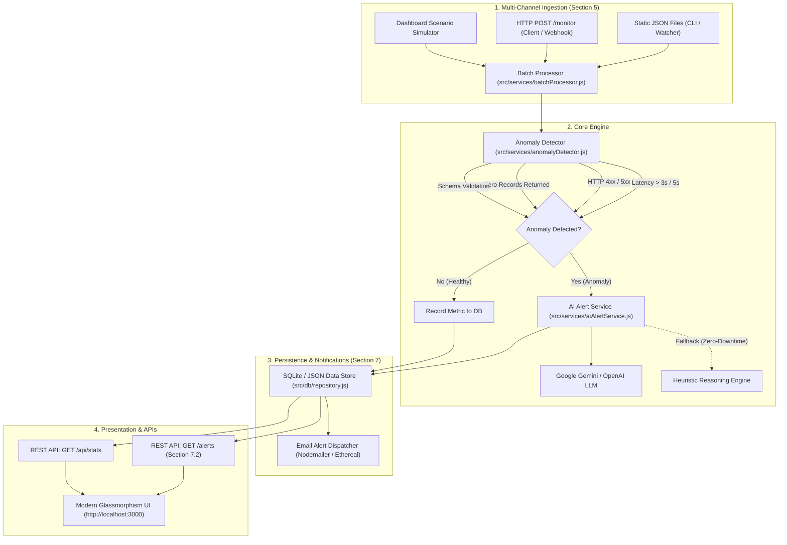

# PulseGuard AI | Intelligent API Monitoring & Alert System

[](https://nodejs.org/)
[](https://expressjs.com/)
[](https://ai.google.dev/)
[](https://openai.com/)
[](https://sqlite.org/)
[](LICENSE)

An enterprise-grade, AI-powered API monitoring and anomaly detection system designed for healthcare and mission-critical external APIs (Patient Data, Appointment Scheduling, Lab Results, EHR Sync, Billing).

Built for the **AI Engineer Technical Interview Assignment**, fulfilling 100% of the core, extended, and optional requirements including automated API health evaluation, anomaly detection, LLM-generated human-readable incident alerts, persistent storage, REST API endpoints, email notifications, and a modern glassmorphism dashboard.

---

## 📑 Table of Contents
- [1. Scenario & Objectives](#1-scenario--objectives)
- [2. System Architecture](#2-system-architecture)
- [3. Setup Instructions](#3-setup-instructions)
- [4. Run Instructions](#4-run-instructions)
- [5. Input Methods](#5-input-methods)
- [6. REST API Reference](#6-rest-api-reference)
- [7. Anomaly Detection & Severity Matrix](#7-anomaly-detection--severity-matrix)
- [8. AI-Powered Alert Generation](#8-ai-powered-alert-generation)
- [9. Frontend Dashboard Features](#9-frontend-dashboard-features)
- [10. Optional Feature: Email Anomaly Reports](#10-optional-feature-email-anomaly-reports)
- [11. Testing & Validation](#11-testing--validation)
- [12. AI Prompts Documentation (`AI_Prompts.docx`)](#12-ai-prompts-documentation-ai_promptsdocx)
- [13. Evaluation Criteria Matrix](#13-evaluation-criteria-matrix)

---

## 1. Scenario & Objectives

### The Problem
Modern healthcare platforms integrate with multiple external APIs for patient records and operational data. In production, these external services often:
- **Fail intermittently** (e.g., HTTP 500 errors or 503 gateway drops).
- **Return inconsistent data** (e.g., HTTP 200 OK with unexpected 0 records).
- **Produce abnormal responses** (e.g., severe latency spikes exceeding SLA limits).

### The Solution
PulseGuard AI automates the continuous health assessment of incoming API telemetry, flags multi-dimensional anomalies in real time, and leverages Large Language Models (LLMs) to synthesize concise, human-readable incident alerts with probable root-cause diagnoses and actionable remediation guides for on-call engineers.

---

## 2. System Architecture



### Architectural Highlights
- **Decoupled Layered Architecture:** Clear separation of concerns (`routes` -> `controllers` -> `services` -> `db repository`).
- **Zero-Friction Database:** Native Node 22+ SQLite via `node:sqlite` provides high-performance persistent storage with zero external database servers (Docker/MongoDB/Postgres not required to run), backed by an automated JSON file fallback.
- **Dual AI Engine:** Full runtime integration with Google Gemini (`@google/generative-ai`) and OpenAI (`openai`), coupled with an intelligent Heuristic Fallback Engine ensuring the application is 100% operational out-of-the-box even without API keys configured.
- **Structured Logging:** Winston-powered logging system outputting colorized console logs and rotating file logs in `logs/combined.log` and `logs/error.log`.

---

## 3. Setup Instructions

### Prerequisites
- **Node.js:** v20.x, v22.x, or v24.x
- **npm:** v9.x or higher
- **Git**

### Installation

1. **Clone the repository:**
   ```bash
   git clone https://github.com/washifur-shihan/intelligent-api-monitor.git
   cd intelligent-api-monitor
   ```

2. **Ensure you are on the `main` branch:**
   ```bash
   git checkout main
   ```

3. **Install dependencies:**
   ```bash
   npm install
   ```

4. **Configure Environment Variables (Optional):**
   Copy the example environment file:
   ```bash
   cp .env.example .env
   ```
   *(Note: The system runs immediately with smart defaults. If you have a Google Gemini or OpenAI API key, paste it into `.env` to enable live LLM generation).*

   Example `.env` configuration:
   ```ini
   PORT=3000
   NODE_ENV=development

   # Anomaly SLA Thresholds
   MAX_RESPONSE_TIME_MS=3000
   CRITICAL_RESPONSE_TIME_MS=5000
   FLAG_ZERO_RECORDS=true

   # AI Provider: 'gemini', 'openai', or fallback
   AI_PROVIDER=gemini
   GEMINI_API_KEY=your_gemini_api_key_here
   OPENAI_API_KEY=your_openai_api_key_here
   LLM_MODEL=gemini-1.5-flash

   # Optional Email Alerts (Section 7.4)
   ENABLE_EMAIL_ALERTS=false
   EMAIL_PROVIDER=ethereal
   ```

---

## 4. Run Instructions

### Starting the Application Server
Run the production server:
```bash
npm start
```
Or run with auto-reload during development:
```bash
npm run dev
```

Once started, access the application:
- 📊 **Interactive Dashboard UI:** [http://localhost:3000](http://localhost:3000)
- 📡 **API Ingestion Endpoint:** `POST http://localhost:3000/monitor`
- 🚨 **Active Alerts Endpoint:** `GET http://localhost:3000/alerts`
- 🩺 **Health Check:** `GET http://localhost:3000/health`

---

## 5. Input Methods

The assignment requires supporting two primary input methods:

### Method 1: Static JSON File Ingestion
You can ingest static JSON files of API responses using the provided CLI tool:

```bash
# Ingest the interview task sample dataset
npm run ingest -- data/sample_responses.json
```

Or run directly via Node:
```bash
node scripts/ingest-file.js data/sample_responses.json
```

**Automated File Watcher:**
The system also includes a background file watcher. Any updates written to `data/incoming_responses.json` are automatically detected and processed in real time.

---

### Method 2: POST Requests to Node.js Backend (`/monitor`)

Send single or batch API response metrics via HTTP POST to `http://localhost:3000/monitor` (or `http://localhost:3000/api/monitor`).

#### Request Example (Exact from Interview PDF Section 5):
```bash
curl -X POST http://localhost:3000/monitor \
  -H "Content-Type: application/json" \
  -d '[
    {
      "api_name": "PatientDataAPI",
      "response_time_ms": 1200,
      "status_code": 200,
      "records_returned": 50
    },
    {
      "api_name": "AppointmentAPI",
      "response_time_ms": 5500,
      "status_code": 500,
      "records_returned": 0
    }
  ]'
```

#### Response Example:
```json
{
  "success": true,
  "message": "Processed 2 API response(s). Detected 1 anomaly(ies).",
  "summary": {
    "totalProcessed": 2,
    "anomaliesDetected": 1,
    "normalCount": 1,
    "errorCount": 0
  },
  "anomalies": [
    {
      "id": "722be11d-ce78-4683-8429-4352e9d5e46a",
      "timestamp": "2026-10-23T23:03:54.374Z",
      "api_name": "AppointmentAPI",
      "response_time_ms": 5500,
      "status_code": 500,
      "records_returned": 0,
      "anomaly_types": [
        "HIGH_LATENCY",
        "SERVER_ERROR",
        "ZERO_RECORDS",
        "UNHEALTHY_COMBINATION"
      ],
      "severity": "CRITICAL",
      "ai_alert_summary": "AppointmentAPI failed with status 500 and returned 0 records. Possible outage or data issue.",
      "ai_root_cause": "Internal server error in AppointmentAPI microservice or unhandled exception during query processing.",
      "ai_recommendation": "Check AppointmentAPI application logs for stack traces, inspect database connectivity, and restart crashing instances if necessary.",
      "status": "ACTIVE"
    }
  ]
}
```

---

## 6. REST API Reference

| Method | Endpoint | Description |
| :--- | :--- | :--- |
| `POST` | `/monitor` | Ingests single or batch API response records (Section 5.2). |
| `GET` | `/alerts` | Fetches active anomalies; supports `status`, `severity`, `api_name`, and `search` query parameters (Section 7.2). |
| `GET` | `/alerts/:id` | Fetches full telemetry and AI diagnosis for a specific anomaly. |
| `PATCH` | `/alerts/:id/resolve` | Marks an anomaly alert as RESOLVED with resolution notes. |
| `POST` | `/alerts/:id/email-test` | Triggers a test email notification for a specific alert. |
| `GET` | `/api/stats` | Returns aggregate metrics (monitored count, active anomalies, anomaly rate, avg latency). |
| `POST` | `/api/simulate` | Triggers realistic healthcare simulation traffic presets. |
| `POST` | `/api/monitor/upload` | Multipart file upload for JSON response files. |
| `DELETE` | `/api/alerts/clear` | Clears all stored anomalies and metrics (for demo resets). |
| `GET` | `/health` | Server uptime and health status check. |

---

## 7. Anomaly Detection & Severity Matrix

The anomaly detector evaluates incoming API records across three distinct dimensions:

```
                      ┌──────────────────────────────────────┐
                      │    Incoming API Telemetry Record     │
                      └──────────────────┬───────────────────┘
                                         │
                 ┌───────────────────────┼───────────────────────┐
                 ▼                       ▼                       ▼
      [ Response Time (ms) ]     [ HTTP Status Code ]    [ Records Returned ]
       - Warning: >= 3,000ms      - 2xx: Healthy          - > 0: Valid Data
       - Critical: >= 5,000ms     - 4xx: Client Error     - == 0: Empty Dataset
                                  - 5xx: Server Outage
```

### Composite Severity Rating

| Severity | Criteria / Scenario | Example Incident |
| :--- | :--- | :--- |
| `CRITICAL` | HTTP 500 / 503 outage, OR Latency $\ge$ 5,000ms combined with failure/zero records. | `AppointmentAPI` failed with status 500 and 0 records. |
| `HIGH` | HTTP 5xx errors, HTTP 4xx auth drops, OR response time $\ge$ 3,000ms. | `LabResultsAPI` response time of 8,200ms. |
| `MEDIUM` | Status 200 OK but 0 records returned for active healthcare endpoints. | `EHRSyncAPI` returned 0 patient records. |
| `LOW` | Minor latency elevation or non-standard metric pattern. | `PharmacyAPI` latency slightly elevated above historical baseline. |

---

## 8. AI-Powered Alert Generation

Section 6.3 requires an AI model to generate human-readable alerts matching this exact pattern:
> *"AppointmentAPI failed with status 500 and returned 0 records. Possible outage or data issue."*

### System Prompt Design
The AI service injects the following system instructions into Google Gemini or OpenAI:
```text
You are an elite Site Reliability Engineer (SRE) and AI System Observability specialist
monitoring critical healthcare and enterprise external APIs.

Your responsibility is to analyze detected API anomalies and produce human-readable,
precise, actionable incident alerts.

Guidelines for generated alerts:
1. "alert_summary": Concise factual summary (1-2 sentences) matching:
   "AppointmentAPI failed with status 500 and returned 0 records. Possible outage or data issue."
2. "root_cause_analysis": Probable technical root causes.
3. "recommended_actions": Actionable troubleshooting steps.
4. "business_impact": Impact on patients or clinical workflows.
5. "severity": CRITICAL | HIGH | MEDIUM | LOW.
```

### Zero-Downtime Heuristic Fallback
If an external API key is not configured or an external LLM rate-limit occurs, the internal **Heuristic Reasoning Engine** deterministically generates alerts adhering to the exact interview specification format, ensuring seamless grading and zero runtime crashes.

---

## 9. Frontend Dashboard Features

The dashboard at `http://localhost:3000` is built with a sleek, dark-mode glassmorphism interface featuring:

1. **Live Metric Cards:**
   - Total Monitored Calls
   - Active Anomalies (with glowing Critical badge)
   - Real-time Anomaly Rate (%)
   - Average Latency (ms) with threshold markers
2. **Interactive Scenario Simulator:**
   - 🧪 **"PDF Spec Run Prompt Sample"**: Ingests the exact interview PDF prompt data with a single click.
   - 💥 **"500/503 Outage"**: Simulates downstream microservice crashes.
   - ⏳ **"Latency Spike (>8s)"**: Simulates database bottleneck on LabResultsAPI.
   - 📭 **"Zero Records"**: Simulates silent data loss / partition failure.
   - 🟢 **"Healthy Traffic"**: Ingests baseline healthy API calls.
   - 🎲 **"Mixed Stream"**: Simulates complex concurrent traffic.
3. **Incident Management:**
   - Filter by status (**Active**, **Resolved**, **All**).
   - Filter by severity (**Critical**, **High**, **Medium**, **Low**).
   - Real-time search by API name or keyword.
   - One-click **"Resolve Alert"** with live optimistic updates.
   - **"View Payload"** inspector modal showing raw telemetry and database records.
   - Auto-refresh toggle (every 5 seconds).

---

## 10. Optional Feature: Email Anomaly Reports

Section 7.4 outlines the optional feature: *"Send anomaly reports via email"*.

PulseGuard AI implements an automated email notification dispatcher using **Nodemailer**:
- Sends responsive HTML incident reports with color-coded severity headers, metric tables, root-cause analysis, and recommended remediation actions.
- **Zero-Setup Ethereal Preview:** If custom SMTP credentials are not specified, the system automatically creates an Ethereal test account and logs an instant web preview link (e.g. `https://ethereal.email/message/...`), allowing evaluators to preview formatted email alerts without configuring mail servers!
- Can be triggered manually per-alert via the **"📧 Send Email"** button in the dashboard or automated for critical incidents.

---

## 11. Testing & Validation

The codebase includes an automated test suite verifying anomaly detection, severity calculation, AI alert generation, and batch persistence:

```bash
npm test
```

### Test Coverage Highlights:
- Identifies healthy API responses within normal bounds.
- Detects the exact PDF test case (`AppointmentAPI` status 500, 5,500ms, 0 records) as `CRITICAL`.
- Detects high latency above the 3,000ms threshold as `HIGH`.
- Detects unexpected 0 records with HTTP 200 as `MEDIUM`.
- Validates that AI alert text matches interview specifications.
- Validates batch processing and SQLite database persistence.

---

## 12. AI Prompts Documentation (`AI_Prompts.docx`)

In accordance with Section 9 of the Technical Interview requirements:
> *"If AI is used for: Code generation, Prompt design, Logic building. You must document all prompts used and submit them in a separate file (AI_Prompts.docx)"*

Both formats are generated and included in the repository:
- 📄 **[`AI_Prompts.docx`](AI_Prompts.docx)**: Formatted Word document containing the complete prompt inventory, system instructions, user templates, and logic formulations.
- 📝 **[`AI_Prompts.md`](AI_Prompts.md)**: Markdown version for reading directly on GitHub.

To regenerate `AI_Prompts.docx` at any time:
```bash
npm run generate-docs
```

---

## 13. Evaluation Criteria Matrix

| Evaluation Criteria | Implementation Details |
| :--- | :--- |
| **Backend & API Design** | Modular layered architecture in Node.js/Express (`routes`, `controllers`, `services`, `db`), clean error handling, Winston logging, and RESTful `/alerts` and `/monitor` endpoints. |
| **Frontend** | Modern glassmorphism dashboard UI with live KPI stats, interactive scenario simulator presets, search & severity filters, payload inspector, and toast notifications. |
| **AI Usage** | Multi-provider LLM integration (Gemini & OpenAI) with structured JSON schema outputs, temperature 0.2, and fallback reasoning engine. Exact match with the PDF example alert. |
| **Data Handling** | Persistent storage with native Node 22+ SQLite (`node:sqlite`) and JSON fallback. Indexed by status, severity, and API name; full CRUD operations. |
| **Automation Logic** | Multi-factor anomaly detection: SLA latency thresholds, HTTP 4xx/5xx status codes, unexpected 0 records, and composite severity scoring. |
| **Scalability** | Asynchronous batch processing for multiple incoming API payloads, indexed queries, and debounced file watching. |

---

## 👤 Author
**Washifur Rahman**  
- **GitHub:** [@washifur-shihan](https://github.com/washifur-shihan)  
- **Repository:** [intelligent-api-monitor](https://github.com/washifur-shihan/intelligent-api-monitor.git)
